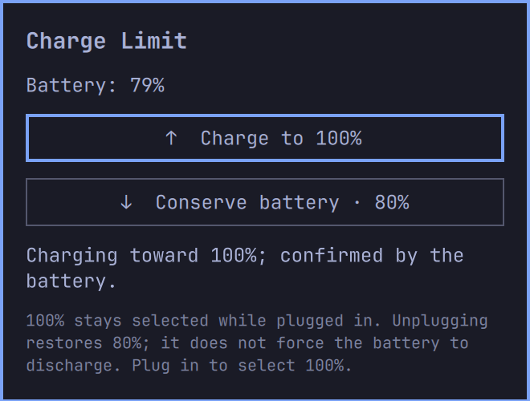

# Omarchy Charge 100 Percent



A small Quickshell toolbar plugin for Omarchy. Click the battery to choose **100% for this plug session** or your normal conservation limit (80% by default).

- **100% stays selected after the battery fills.** Firmware handles top-ups using 99–100% start/stop thresholds.
- **Unplugging restores conservation**, normally 75–80%. Reconnecting does not select 100% again.
- The current profile has a theme-accent outline; the battery fill shows its charge level.
- **↑ is hardware-confirmed:** AC connected, 99–100% thresholds, and Charging or Full (or Not charging at 100%). A selected limit alone is not proof of charging.
- **↓** confirms the conservation limit. `?` means operation is not confirmed; the chooser explains the state.
- No automatic popups, network requests, telemetry, or CPU power-profile changes.

## Requirements

- Omarchy with the plugin-capable Quickshell shell (`qs.Ui`, `qs.Commons`, UPower); tested on Omarchy 4.5.
- A Linux battery exposing **both** `charge_control_start_threshold` and `charge_control_end_threshold`, supporting 99–100% and 75–80% thresholds. Not every laptop does.
- Bash, coreutils, util-linux (`flock`, `setsid`), and sudo when using the privileged helper.

The first threshold-capable battery is controlled. Firmware may allow small fluctuations below 100%; the plugin does not force-discharge the battery when conservation is restored.

## Install

Plugins run unsandboxed inside your shell. Review the source before installation:

```bash
omarchy plugin add https://github.com/k7cfo/omarchy-charge-100-percent --enable
omarchy bar move io.github.k7cfo.charge-100-percent --before omarchy.power
```

### Explicit one-time permission setup

If the machine already has a compatible `/usr/local/sbin/set-battery-charge-thresholds`, the plugin reuses it. Otherwise review `scripts/install-helper` and `scripts/set-battery-charge-thresholds`, then explicitly run:

```bash
sudo ~/.config/omarchy/plugins/io.github.k7cfo.charge-100-percent/scripts/install-helper
```

**This is manual setup, not an automatic install hook.** It installs a root-owned helper and, unless an existing ThinkPad charge rule is present, `/etc/sudoers.d/omarchy-charge`. That rule permits only the helper, not an arbitrary shell. The helper validates numeric arguments and writes only the selected battery's start/stop thresholds. The installer initializes the cap to 75–80%. No packages, services, or autostart entries are installed.

Do not run this alongside competing charge policies (including older versions of Charge Limit). Disable or reconfigure those explicitly first. Existing timers or boot policies must use the same limits and must not cancel full charge when it reaches 99%.

## Use

| Input | Action |
|---|---|
| Click the battery | Open or close chooser |
| Click a profile | Apply it and show the hardware result |
| `1` / `2` | Full charge / conservation, top to bottom |
| `Esc` or click outside | Close without changing the profile |

The service reacts to UPower unplug events and reconciles the policy every 15 seconds. The indicator refreshes after actions, power-state changes, and periodically. Full charge is disabled when AC is not detected. The theme is followed live. English translations are bundled with Omarchy's language fallback mechanism.

`conserveEnd` in the widget settings defaults to 80; its start threshold is five points lower. If a separate fallback controller exists, keep its configuration aligned.

The shell must be running to observe unplug events immediately. An unplug/replug entirely while powered off or asleep cannot be detected by this plugin. It does not install a boot reset policy; an independently configured conservation-at-boot policy is recommended.

## Command line

From the plugin directory:

```bash
./scripts/charge-ctl status --json
./scripts/charge-ctl full
./scripts/charge-ctl conserve
./scripts/charge-ctl tick
```

`travel` is another name for `full`. Set `CHARGE_CONSERVE_END` for CLI calls when using a non-default cap. Hardware write failures are not reported as successful selections. Mutating calls share a lock; a disconnect during a full-charge write restores conservation before completion.

## Remove safely

Restore conservation before removal:

```bash
~/.config/omarchy/plugins/io.github.k7cfo.charge-100-percent/scripts/charge-ctl conserve
omarchy plugin remove io.github.k7cfo.charge-100-percent
```

The helper, sudoers rule, and state are intentionally not removed automatically: another charge controller may share them. If nothing else uses them, an administrator can remove `/etc/sudoers.d/omarchy-charge` and `/usr/local/sbin/set-battery-charge-thresholds`. Do not delete a pre-existing `thinkpad-smart-charge` rule or helper used by another tool. Check any timers or executable symlinks before deleting their target files.

State lives under `${XDG_STATE_HOME:-$HOME/.local/state}/omarchy/smart-charge/`. Preserve it if another controller uses it. Removing the plugin while full charge is selected disables its unplug watcher; restore conservation first.

## Security and privacy

No credentials or network access are required. The plugin reads power-supply sysfs and writes its own mode state. Only the explicitly installed helper performs privileged threshold writes. The helper accepts percentages, not paths or commands. State updates are atomic and unchanged state is not rewritten. Reads are bounded and avoid following final-component symlinks; helper output is capped with a deadline. UI text is plain text, with shared button/tooltip text sanitized.

The marketplace's baseline should require manual review for the installer, privilege use, and sudoers modification. These capabilities are intentional and disclosed, not hidden. Marketplace listing is not a security audit, certification, or endorsement.

## Development checks

```bash
python3 tests/test_controller.py
node tests/test_model.js
omarchy plugin validate .
for script in scripts/*; do bash -n "$script"; done
node --check Model.js
```

Tests use isolated battery files, never real sysfs writes or sudo. They cover full-charge retention, unplug/replug, offline rejection, write failure, stale state, disconnect during a write, hardware status, indicator gating, and markup-safe display text. Node and Python are development-only dependencies.

Standalone `qmllint` needs Omarchy's shell exposed as a `qs` import. Current installed framework metadata produces warnings for dynamic theme properties and JavaScript maps assigned to Quickshell's `QVariantHash` environment; those paths have been checked at runtime. Warnings are not suppressed.

## License

MIT. See [LICENSE](LICENSE).
